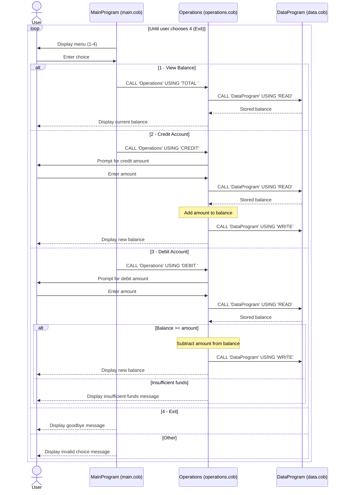

# COBOL Account Management System

This directory documents the COBOL account management example in `src/cobol`. The program provides a menu to view an account balance, credit the account, or debit it. Although it could be used as a basic student-account exercise, the code does not identify students or implement student-specific policies.

## COBOL programs

### `main.cob` — `MainProgram`

Runs the interactive menu and dispatches operations to `Operations`:

- `1` requests the current balance (`TOTAL `).
- `2` starts a credit (`CREDIT`).
- `3` starts a debit (`DEBIT `).
- `4` exits; other choices display an invalid-choice message.

The menu repeats until the user chooses to exit.

### `operations.cob` — `Operations`

Implements the account actions and user interaction:

- For `TOTAL `, reads and displays the balance.
- For `CREDIT`, accepts an amount, reads the balance, adds the amount, writes the result, and displays it.
- For `DEBIT `, accepts an amount and reads the balance. It subtracts and writes the result only when the balance is at least the requested amount; otherwise, it displays an insufficient-funds message.

It calls `DataProgram` to read or write the balance.

### `data.cob` — `DataProgram`

Provides the balance storage interface. `READ` copies the stored balance to the caller; `WRITE` replaces the stored balance with the caller's value. The working-storage balance starts at `1000.00`.

## Account rules and limitations

- The starting balance is `1000.00`.
- A debit is allowed only if the current balance is greater than or equal to the debit amount; this prevents the balance from going below zero for an accepted debit.
- Credits increase the balance. The program does not define a student-specific credit policy or validate that an entered amount is positive.
- Amounts and balances use a numeric field with six integer digits and two decimal places. The program does not implement explicit validation or error handling for amounts outside that field's range.
- The balance is held in COBOL working storage, not a database or file. Updates last only for the current program run.
- No student records, identifiers, tuition rules, fees, account limits, or other student-specific business rules are implemented.

## Data flow sequence diagram

